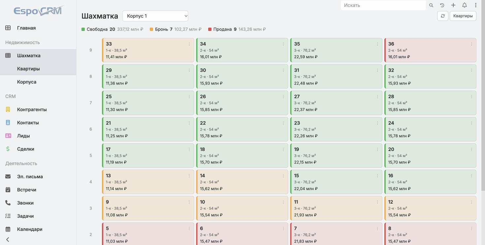

# Шахматка квартир для EspoCRM

Раздел для отдела продаж недвижимости: все квартиры корпуса видны одной сеткой —
этажи по вертикали, квартиры по горизонтали, цвет клетки показывает статус.
Надстройка над EspoCRM 10, работает в Docker, ядро CRM не изменяется.



## Что реализовано

**Шахматка** — отдельный раздел по адресу `#CApartment/chessboard`:

- этажи сверху вниз (верхний этаж наверху), квартиры слева направо по полю «Позиция на этаже»;
- в клетке номер, комнатность, площадь и цена, цвет — по статусу;
- выбор корпуса, если их несколько;
- легенда со счётчиками и суммами: сколько свободно, в броне и продано, на какие деньги;
- клик по квартире открывает её карточку модальным окном, без ухода со страницы;
- троеточие в углу клетки (или правый клик) меняет статус на месте. Если сервер
  отказал — например, не хватает прав, — клетка возвращает прежний цвет;
- квартиры без пары «этаж + позиция» в сетку не попадают, пустые места показаны пунктиром.

**Две сущности:**

| Сущность | Поля |
|---|---|
| Корпус (`CBuilding`) | название, адрес, этажей, квартир на этаже |
| Квартира (`CApartment`) | номер, корпус, этаж, позиция на этаже, комнат, площадь, цена, статус, примечание |

Статус — список из трёх значений: свободна, бронь, продана. Цвета заданы в метаданных,
поэтому одинаково выглядят и в шахматке, и в списке, и в карточке.

**Прочее:** разделы добавлены в меню CRM группой «Недвижимость», в списке квартир
есть кнопка перехода на шахматку, интерфейс русский, цены в рублях.

## Требования

- Docker с поддержкой `docker compose`.
  На macOS подойдёт и Docker Desktop, и colima — в colima нужно сначала поднять
  машину: `colima start`.
- Свободные порты 8080 и 8081 (меняются в `.env`).

## Запуск

```bash
cp .env.example .env     # и задать в нём свои пароли
docker compose up -d     # первый запуск скачивает образы, несколько минут
```

Когда контейнеры станут `healthy`, открыть http://localhost:8080 и войти с логином
и паролем из `.env`. **Сразу после первого входа пароль стоит сменить в профиле:**
переменные из `.env` действуют только при первой установке.

Дальше выложить кастомизации в контейнер:

```bash
./deploy.sh
```

Скрипт копирует код в примонтированные тома и пересобирает кэш EspoCRM. После него
в браузере нужно обновить страницу с `Ctrl+Shift+R` — браузер кэширует метаданные.

Русский интерфейс и рублёвый формат чисел:

```bash
docker cp espo-custom/tools/locale.php espocrm:/var/www/html/locale.php
docker exec -u www-data espocrm php /var/www/html/locale.php
docker exec -u www-data espocrm php bin/command clear-cache
docker exec espocrm rm /var/www/html/locale.php
```

Раздел «Недвижимость» в меню CRM:

```bash
docker cp espo-custom/tools/menu.php espocrm:/var/www/html/menu.php
docker exec -u www-data espocrm php /var/www/html/menu.php
docker exec -u www-data espocrm php bin/command clear-cache
docker exec espocrm rm /var/www/html/menu.php
```

Демонстрационные данные — корпус на 9 этажей по 4 квартиры:

```bash
docker cp espo-custom/tools/seed.php espocrm:/var/www/html/seed.php
docker exec -u www-data espocrm php /var/www/html/seed.php
docker exec espocrm rm /var/www/html/seed.php
```

Скрипт идемпотентный: повторный запуск ничего не дублирует.

## Повседневные команды

```bash
docker compose stop            # остановить, данные сохраняются
docker compose start           # запустить снова
docker compose logs -f espocrm # смотреть логи
./deploy.sh                    # выложить изменения кода
```

Резервная копия базы:

```bash
docker exec espocrm-db sh -c 'mariadb-dump -uroot -p"$MARIADB_ROOT_PASSWORD" \
  --single-transaction espocrm' | gzip > backups/espocrm-$(date +%Y%m%d-%H%M).sql.gz
```

`docker compose down --volumes` (он же `-v`) **удаляет базу вместе со всеми данными CRM.**
Для остановки нужен `stop`, а не `down`.

## Структура проекта

```
docker-compose.yml          четыре контейнера: CRM, база, демон, websocket
.env.example                шаблон настроек, свой .env в репозиторий не попадает
deploy.sh                   выкладка кастомизаций в работающий контейнер
espo-custom/
  backend/Espo/Custom/      серверная часть → том /var/www/html/custom
    Controllers|Entities|Services|Repositories/   классы-заглушки сущностей
    Resources/metadata/     описание сущностей, полей и связей
    Resources/layouts/      раскладки списка, карточки и фильтров
    Resources/i18n/         переводы ru_RU и en_US
  client/src/               клиентская часть → том /var/www/html/client/custom
    controllers/c-apartment.js        маршрут #CApartment/chessboard
    views/c-apartment/chessboard.js   сама шахматка
  tools/
    seed.php                демонстрационные корпус и квартиры
    locale.php              русская локаль и формат чисел
    menu.php                раздел «Недвижимость» в меню CRM
docs/                       скриншоты
```

Код живёт в репозитории, а в контейнер попадает через `deploy.sh` (`docker cp` + `rebuild`).
Так исходники остаются под git, а `docker-compose.yml` не обрастает лишними монтированиями.

## Как это устроено

Шахматка — обычная клиентская вьюха EspoCRM, серверного кода у неё нет: данные берутся
штатным REST API, статус сохраняется запросом `PUT /api/v1/CApartment/{id}`. Права
проверяет сам EspoCRM, отдельной логики доступа в шахматке нет.

Три вещи, на которые стоит обратить внимание при доработке:

1. **Кастомной сущности нужны PHP-классы-заглушки** в `Controllers`, `Entities`,
   `Services` и `Repositories`. Без них API отвечает 404 «Controller does not exist».
   Обычно их создаёт Entity Manager; здесь они лежат в репозитории.
2. **В EspoCRM 10 клиент собран в бандлы**, исходников `client/src` в образе нет.
   Свой код грузится из `client/custom/src` по префиксу `custom:` — это работает,
   но примеров из документации под старые версии там не найти.
3. **Настройки CRM лежат вне git** — в `data/config.php` внутри тома Docker.
   Поэтому язык, формат чисел и состав меню вынесены в скрипты `tools/locale.php`
   и `tools/menu.php`: иначе на новой установке их пришлось бы повторять руками.
4. **Кэш двухслойный.** После правок нужен `rebuild` на сервере (его делает `deploy.sh`)
   и жёсткое обновление страницы в браузере.

## Чего пока нет

- Связи квартиры со сделкой или контактом: кто именно забронировал — не фиксируется.
- Ролей доступа: разделы видны администратору, роль «Отдел продаж» не настроена.
- Истории изменений статуса в виде отчёта (сами изменения пишутся в аудит поля).
